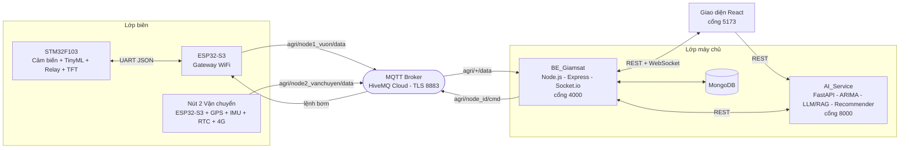

<div align="center">

# Hệ gợi ý Nông nghiệp Khép kín Thông minh

**Smart Closed-Loop Agriculture Recommendation System**

Hệ sinh thái IoT + AI kết nối xuyên suốt từ **canh tác** đến **vận chuyển lạnh** nông sản:
suy luận tại biên (TinyML) · dự báo chuỗi thời gian (ARIMA) · trợ lý ảo (LLM + RAG) · gợi ý cây trồng (Cosine Similarity).


*Đồ án cuối kỳ môn **Trí tuệ nhân tạo** — Khoa Công nghệ Thông tin, Trường Đại học Văn Lang*

</div>

---

## Mục lục

1. [Giới thiệu](#1--giới-thiệu)
2. [Tính năng chính](#2--tính-năng-chính)
3. [Kiến trúc hệ thống](#3--kiến-trúc-hệ-thống)
4. [Công nghệ sử dụng](#4--công-nghệ-sử-dụng)
5. [Cấu trúc thư mục](#5--cấu-trúc-thư-mục)
6. [Phần cứng](#6--phần-cứng)
7. [Cài đặt và chạy](#7--cài-đặt-và-chạy)
8. [Cấu hình biến môi trường](#8--cấu-hình-biến-môi-trường)
9. [Quy ước MQTT](#9--quy-ước-mqtt)
10. [Tài liệu API](#10--tài-liệu-api)
11. [Firmware](#11--firmware)
12. [Kiểm thử và hiện trạng](#12--kiểm-thử-và-hiện-trạng)
13. [Hạn chế đã biết](#13--hạn-chế-đã-biết)
14. [Hướng phát triển](#14--hướng-phát-triển)
15. [Nhóm thực hiện](#15--nhóm-thực-hiện)
16. [Tài liệu liên quan và giấy phép](#16--tài-liệu-liên-quan-và-giấy-phép)

---

## 1. Giới thiệu

### Bối cảnh

Nông nghiệp Việt Nam đang đối mặt với hai vấn đề liên quan chặt chẽ:

- **Canh tác, tưới tiêu** còn phụ thuộc kinh nghiệm và thời tiết; nhiều giải pháp thông minh cần Internet liên tục trong khi hạ tầng mạng vùng nông thôn còn hạn chế.
- **Vận chuyển lạnh** gần như là một "hộp đen": nhiệt độ, độ ẩm, hành trình không được ghi nhận liên tục nên khó truy xuất nguồn gốc và xác định nguyên nhân hư hỏng.

Các giải pháp hiện có thường chỉ giải quyết riêng lẻ từng khâu và chỉ dùng một lớp AI.

### Giải pháp

Dự án xây dựng một **hệ sinh thái khép kín** gồm hai nút cảm biến biên và một nền tảng máy chủ, tích hợp **ba lớp AI bổ trợ nhau**:

| Lớp AI | Vị trí chạy | Vai trò |
| --- | --- | --- |
| **TinyML** (cây quyết định) | Vi điều khiển STM32F103 | Quyết định bật/tắt bơm tưới ngay tại biên, **hoạt động cả khi mất mạng** |
| **ARIMA** | Máy chủ (FastAPI) | Dự báo ngắn hạn độ ẩm đất, nhiệt độ, độ ẩm không khí kèm khoảng tin cậy |
| **LLM + RAG** | Máy chủ (FastAPI) | Diễn giải số liệu cảm biến, tư vấn canh tác bằng tiếng Việt, trả lời kèm nguồn dữ liệu |

Ngoài ra, **hệ gợi ý cây trồng** kết hợp độ tương đồng cosine với luật lọc theo vùng miền để đề xuất cây phù hợp điều kiện vườn thực tế.

> **Nguyên tắc an toàn:** LLM chỉ *diễn giải và khuyến nghị*, **không điều khiển bơm trực tiếp**. Việc chấp hành thuộc về TinyML (tự động) hoặc người dùng (thủ công), vì quyết định chấp hành cần tính xác định.

### Mục tiêu

1. Nút **"Vườn"** (STM32) tự quyết định tưới bằng TinyML mà không cần Internet.
2. Nút **"Vận chuyển"** (ESP32-S3) giám sát nhiệt độ, độ rung, định vị GPS trên xe lạnh.
3. Nền tảng Web (React) và Backend (Node.js, MongoDB) hiển thị dữ liệu thời gian thực.
4. Hệ gợi ý đề xuất cây trồng phù hợp điều kiện môi trường.
5. Trợ lý ảo LLM hiểu ngôn ngữ tự nhiên, tư vấn vùng miền và kỹ thuật canh tác.

---

## 2. Tính năng chính

### Nút 1 — "Vườn"
- Đo nhiệt độ, độ ẩm không khí, áp suất, khí gas (BME680), cường độ ánh sáng (BH1750), độ ẩm đất (cảm biến điện dung, ADC).
- **TinyML** (cây quyết định) chạy trên STM32 điều khiển relay bơm; ngưỡng tham chiếu độ ẩm đất **35%**.
- Hai chế độ: **TỰ ĐỘNG** (TinyML nắm quyền) và **THỦ CÔNG** (điều khiển từ web, độc lập với TinyML).
- Màn hình TFT hiển thị thông số và trạng thái bơm tại chỗ.
- Watchdog độc lập (**IWDG**) tự khởi động lại khi chương trình treo.

### Nút 2 — "Vận chuyển"
- Môi trường hàng hóa (BME680), độ rung (MPU6500), thời gian chính xác (DS3231), định vị (GPS ATGM336H).
- Truyền dữ liệu qua **WiFi** (kiểm thử) hoặc **4G A7680C** (cờ `USE_GSM` trong firmware).
- Giữ dấu thời gian đúng khi mất GPS; vị trí được đánh dấu "không còn mới".

### Nền tảng giám sát
- Backend **Node.js / Express** nhận MQTT, lưu **MongoDB**, đẩy thời gian thực qua **Socket.io**.
- Các màn hình: Tổng quan · Vườn thông minh · Hành trình · Dự báo ARIMA · Trợ lý nông nghiệp · Truy xuất QR.
- Cảnh báo khi vượt ngưỡng (độ ẩm đất, nhiệt độ, độ ẩm không khí, ánh sáng, va đập khi vận chuyển).
- Truy xuất nguồn gốc bằng mã QR theo mã chuyến hoặc mã lô.

### Dịch vụ AI (`AI_Service`)
- **ARIMA** chọn mô hình theo AIC trong tập `(1,1,1) (2,1,1) (1,1,2) (2,1,2)`; tự hạ độ phân giải gộp dữ liệu (1h → 30 → 15 → 10 → 5 phút) khi dữ liệu còn ít, đồng thời công bố độ phân giải và tầm nhìn thực tế trong kết quả.
- **Trợ lý LLM** (Gemini hoặc OpenAI) theo cấu trúc *Nhận định – Cảnh báo – Khuyến nghị – Nguồn dữ liệu*. Khi chưa có khóa API, tự chuyển sang **bộ luật dự phòng** (giao diện hiện nhãn "RAG dự phòng") và vẫn trả lời dựa trên số đo thật.
- **Hệ gợi ý cây trồng** (`recommender.py`): chuẩn hóa câu hỏi (không dấu, viết tắt, sai chính tả nhẹ), xếp hạng kết hợp **Cosine Similarity** với khoảng cách theo độ ẩm đất / nhiệt độ / ánh sáng, lọc theo vùng miền và giá trị thị trường, có dự phòng kinh tế khi cây người dùng muốn trồng không hợp điều kiện.
- Cảnh báo được **suy ra từ số đo 24 giờ gần nhất** mỗi lần cần (không lưu sẵn) để luôn nhất quán với ngưỡng đang dùng.

---

## 3. Kiến trúc hệ thống



**Vì sao đặt MQTT broker trên cloud?** Nút 2 truy cập Internet qua SIM của nhà mạng nên không thể kết nối tới broker chạy trên laptop nằm sau NAT. Khi broker ở cloud, cả hai nút và backend chỉ mở kết nối *đi ra* → không cần IP công khai hay mở cổng router.

### Luồng dữ liệu

1. Nút đọc cảm biến theo chu kỳ → đóng gói JSON → publish lên `agri/<node_id>/data`.
2. Backend subscribe `agri/+/data` → kiểm tra hợp lệ, bổ sung dấu thời gian nếu thiếu → lưu MongoDB → đẩy sự kiện Socket.io tới giao diện.
3. `AI_Service` **không giữ cơ sở dữ liệu riêng**: đọc số đo thật từ backend qua REST, chạy mô hình, gửi kết quả ngược lại để lưu.
4. Lệnh bơm từ web đi theo chiều ngược lại: Backend → MQTT `agri/<node_id>/cmd` → ESP32-S3 → UART → STM32.

### Vòng tưới tự động trên STM32

```
Mỗi chu kỳ T:
  1. Đọc độ ẩm đất qua ADC
  2. Nếu chế độ = THỦ CÔNG  → bơm theo lệnh từ web
  3. Nếu chế độ = TỰ ĐỘNG   → quyết định = cây_quyết_định(độ ẩm đất, nhiệt độ, ánh sáng)
  4. Ghi relay, cập nhật TFT
  5. Gửi trạng thái cho ESP32-S3 (UART) để publish MQTT
```

| Chế độ | Nguồn quyết định | Nút bật/tắt trên web | Khi mất mạng |
| --- | --- | --- | --- |
| TỰ ĐỘNG | TinyML trên STM32 | Khóa | Vẫn hoạt động |
| THỦ CÔNG | Lệnh từ web qua backend và MQTT | Mở | Cần mạng |

---

## 4. Công nghệ sử dụng

| Thành phần | Công nghệ |
| --- | --- |
| Firmware Nút 1 (STM32) | C, STM32CubeIDE, thư viện HAL |
| Firmware Nút 1 gateway và Nút 2 | Arduino Framework, PubSubClient, ArduinoJson 7, TinyGPSPlus, RTClib, Adafruit BME680 |
| Backend | Node.js ≥ 20.19, Express, Mongoose, MQTT.js, Socket.io |
| Cơ sở dữ liệu | MongoDB (Atlas hoặc Community) |
| MQTT broker | HiveMQ Cloud (Serverless Free); Aedes cho broker cục bộ khi thử nghiệm |
| Dịch vụ AI | Python, FastAPI, Uvicorn, statsmodels, scikit-learn, pandas, numpy |
| LLM | Gemini (mặc định) hoặc OpenAI; có chế độ dự phòng không cần khóa |
| Giao diện | React, Leaflet + OpenStreetMap (bản đồ hành trình) |

---

## 5. Cấu trúc thư mục

```
AI_ProjectCuoiKy_NongNghiepKhepKin/
├── AI_Service/                    # Dịch vụ AI (FastAPI, cổng 8000)
│   ├── app/
│   │   ├── main.py                # Các endpoint HTTP
│   │   ├── schemas.py             # Schema dữ liệu (Pydantic)
│   │   ├── node_repository.py     # Đọc dữ liệu từ backend Node, lưu kết quả ngược lại
│   │   └── ai/
│   │       ├── arima.py           # Dự báo chuỗi thời gian
│   │       ├── llm.py             # Trợ lý RAG (Gemini/OpenAI/dự phòng)
│   │       ├── recommender.py     # Hệ gợi ý cây trồng
│   │       ├── tinyml.py          # Cây quyết định phía máy chủ (để đối chiếu với bản nhúng)
│   │       ├── ai_router.py       # Router /recommend và /llm
│   │       └── crop_data.csv      # Cơ sở dữ liệu cây trồng
│   ├── requirements.txt
│   └── .env.example
│
├── BE_Giamsat/                    # Backend (Node.js, cổng 4000)
│   ├── server.js
│   ├── src/                       # config, ingest, routes, models, state, coldchain, transform
│   ├── tools/                     # dev-broker, fake-node (giả lập), seed
│   └── .env.example
│
├── FE_Giam-sat/                   # Giao diện web React (cổng 5173)
│
├── firmware/
│   ├── node1_stm32_link/          # STM32: module UART (agri_link) + main
│   ├── node1_vuon_mqtt/           # ESP32-S3 Nút 1: gateway UART ↔ MQTT
│   ├── node2_vanchuyen/           # ESP32-S3 Nút 2: cảm biến + MQTT (WiFi/4G)
│   └── secrets_example.h          # Mẫu thông tin WiFi/MQTT/APN
│
├── START-DEMO.cmd                 # Chạy thử toàn hệ thống với node giả lập
├── START-ALL.cmd                  # Chạy toàn hệ thống với phần cứng thật
└── CHAY_DEMO.bat                  # Script demo (cần sửa đường dẫn trước khi dùng)
```


> **Mã nguồn giao diện (frontend) hiện chưa có trong repository.** Thư mục `FE_Giam-sat/` chỉ chứa `package-lock.json` rỗng và `FE_Giamsat` là một liên kết submodule bị hỏng (không có `.gitmodules`). Cần đẩy mã nguồn React lên repo trước khi các lệnh ở [mục 7](#7--cài-đặt-và-chạy) chạy được phần giao diện.

---

## 6. 🔌 Phần cứng

### Nút 1 — "Vườn"

| Thiết bị | SL | Vai trò |
| --- | :-: | --- |
| STM32F103 (Cortex-M3) | 1 | Vi điều khiển trung tâm: đọc cảm biến, chạy TinyML, điều khiển relay |
| ESP32-S3 DevKit | 1 | Cổng kết nối mạng, truyền MQTT |
| BME680 | 1 | Nhiệt độ, độ ẩm, áp suất, khí gas (I²C `0x76`) |
| BH1750 | 1 | Cường độ ánh sáng (I²C) |
| Cảm biến độ ẩm đất điện dung | 1 | Đầu vào TinyML (ADC) |
| Relay 1 kênh + bơm mini 3–5 V | 1 | Cơ cấu chấp hành tưới |
| Pin Li-ion 18650 3,7 V + đế | 1 | Nguồn nhánh bơm |
| Màn hình TFT (ST7735) | 1 | Hiển thị tại chỗ |
| Bộ nạp ST-Link hoặc USB-UART | 1 | Nạp firmware STM32 |

**Đấu dây STM32 ↔ ESP32-S3** (UART 115200 8N1, mức 3,3 V, không cần chuyển mức):

| STM32F103 | | ESP32-S3 |
| --- | :-: | --- |
| PA9 (USART1_TX) | → | GPIO17 (RX) |
| PA10 (USART1_RX) | ← | GPIO16 (TX) |
| GND | ↔ | GND |

### Nút 2 — "Vận chuyển"

| Thiết bị | SL | Vai trò |
| --- | :-: | --- |
| ESP32-S3 DevKit | 1 | Vi điều khiển Nút 2 |
| BME680 | 1 | Môi trường hàng hóa (`0x76`) |
| MPU6500 (chân ADO nối 3V3) | 1 | Gia tốc, con quay: đo rung (`0x69`) |
| DS3231 + pin CR2032 | 1 | Dấu thời gian chính xác (`0x68`) |
| GPS ATGM336H + ăng-ten | 1 | Định vị (UART) |
| SIMCom A7680C + ăng-ten + SIM data | 1 | Truyền dữ liệu di động (UART) |

### Danh sách kiểm tra trước khi chạy

- [ ] **Chung GND** giữa MCU, module GSM, relay và nguồn (thiếu GND chung từng làm A7680C không phản hồi).
- [ ] Nguồn bơm trong dải **3–4,2 V**; không nối hai cell 18650 nối tiếp cho bơm.
- [ ] Quét I²C thấy đủ `0x68`, `0x69`, `0x76`.
- [ ] GPS đặt ngoài trời, nhìn thấy bầu trời.
- [ ] A7680C cấp **nguồn riêng** (dòng đỉnh có thể vượt 2 A, không cấp từ chân 5V của ESP32).
- [ ] Broker, MongoDB và backend đã chạy; giao diện hiện "MQTT Connected" và "Backend Ready".

---

## 7. Cài đặt và chạy

### Yêu cầu hệ thống

| Công cụ | Phiên bản |
| --- | --- |
| Node.js | ≥ 20.19 |
| Python | 3.10 trở lên *(khuyến nghị 3.11+)* |
| MongoDB | Atlas (khuyến nghị) hoặc Community |
| Hệ điều hành | Các script `.cmd`/`.bat` dành cho **Windows**; trên macOS/Linux chạy từng dịch vụ thủ công |

### Bước 0 — Tải mã nguồn

```bash
git clone https://github.com/tmewwoo7769/AI_ProjectCuoiKy_NongNghiepKhepKin.git
cd AI_ProjectCuoiKy_NongNghiepKhepKin
```

### Bước 1 — Chuẩn bị MongoDB

<details>
<summary><b>Cách A — MongoDB Atlas (không cần cài đặt)</b></summary>

1. Tạo tài khoản tại [mongodb.com/atlas](https://www.mongodb.com/atlas) và tạo cluster miễn phí **M0**.
2. *Database Access* → tạo user.
3. *Network Access* → thêm IP hiện tại (hoặc `0.0.0.0/0` khi demo ở nhiều nơi).
4. Sao chép connection string dạng `mongodb+srv://...` vào `MONGO_URL`.

</details>

<details>
<summary><b>Cách B — MongoDB Community trên máy</b></summary>

Tải tại [mongodb.com/try/download/community](https://www.mongodb.com/try/download/community), cài với tùy chọn *Install MongoDB as a Service*. Giữ nguyên `MONGO_URL=mongodb://127.0.0.1:27017/agri_ecosystem`. Kiểm tra dịch vụ:

```powershell
Get-Service MongoDB
```

</details>

### Bước 2 — Cấu hình và chạy Backend

```powershell
cd BE_Giamsat
npm install
Copy-Item .env.example .env     # sau đó mở .env và điền thông tin
npm start
```

Chạy đúng sẽ thấy:

```
Da ket noi MongoDB: ...
Backend chay tai http://localhost:4000
Da ket noi MQTT broker: ...
Dang lang nghe topic: agri/+/data
```

### Bước 3 — Cài đặt và chạy AI Service

```powershell
cd AI_Service
python -m venv .venv
.venv\Scripts\pip install -r requirements.txt
Copy-Item .env.example .env
.venv\Scripts\python.exe -m uvicorn app.main:app --host 127.0.0.1 --port 8000
```

<sub>macOS/Linux: `source .venv/bin/activate && pip install -r requirements.txt && uvicorn app.main:app --port 8000`</sub>

> **Backend Node phải chạy trước**, vì `AI_Service` lấy dữ liệu từ đó. Trang thử API: <http://127.0.0.1:8000/docs>.

### Bước 4 — Chạy giao diện

```powershell
cd FE_Giam-sat
npm install
npm run dev        # http://localhost:5173
```

*(Xem cảnh báo về frontend ở [mục 5](#5--cấu-trúc-thư-mục).)*

### Chạy nhanh bằng script (Windows)

| Script | Khi nào dùng | Mở các tiến trình |
| --- | --- | --- |
| `START-DEMO.cmd` | **Chưa có phần cứng** — dùng node giả lập | Broker cục bộ (nếu `.env` trỏ `localhost`) → Backend → Node giả lập → Frontend |
| `START-ALL.cmd` | Có phần cứng thật, broker trên cloud | Backend → AI Service → Frontend |

> `CHAY_DEMO.bat` đang chứa đường dẫn cứng `D:\Eureka\...`; hãy sửa theo máy của bạn hoặc dùng hai script ở trên.

### Kiểm thử khi chưa có phần cứng

Toàn bộ đường dữ liệu chạy được mà không cần ESP32, thậm chí không cần tài khoản HiveMQ:

```powershell
cd BE_Giamsat
npm run broker      # Terminal 1: broker MQTT cục bộ (đặt MQTT_URL=mqtt://localhost:1883, xóa MQTT_USER/MQTT_PASS)
npm start           # Terminal 2: backend
npm run fake        # Terminal 3: giả lập cả hai nút
```

Node 1 giả lập mô phỏng **cả vòng lặp khép kín**: bơm chạy → độ ẩm đất tăng; bơm tắt → đất khô dần; cây quyết định bật/tắt bơm theo ngưỡng 35%; và lắng nghe topic lệnh nên nút điều khiển bơm trên web hoạt động thật.

Gửi đúng một bản tin để kiểm tra nhanh, rồi đọc lại:

```powershell
node tools/fake-node.js --node2 --once
curl http://localhost:4000/api/nodes/node2_vanchuyen/latest
curl http://localhost:4000/api/nodes/node2_vanchuyen/history
```

Các lệnh tiện ích khác:

```powershell
node tools/seed.js --threshold 35      # nâng ngưỡng nhiệt chuỗi lạnh khi thử trên bàn (mặc định 8 °C)
node tools/seed.js --reset-readings    # xóa dữ liệu để bắt đầu lại
```

### Thiết lập HiveMQ Cloud (khi dùng phần cứng thật)

1. Vào [hivemq.com/mqtt-cloud-broker](https://www.hivemq.com/mqtt-cloud-broker/) → *Start free* → tạo cluster **Serverless (Free)**.
2. Tab **Access Management** → *Add credentials*, quyền **Publish and Subscribe**.
3. Tab **Overview** → lấy **Cluster URL** (dạng `xxxxx.s1.eu.hivemq.cloud`, cổng TLS `8883`).
4. Điền vào `BE_Giamsat/.env`:

```env
MQTT_URL=mqtts://xxxxx.s1.eu.hivemq.cloud:8883
MQTT_USER=<username>
MQTT_PASS=<password>
```

---

## 8. Cấu hình biến môi trường

> **Không commit file `.env`** và không đặt khóa API trong mã nguồn hay frontend. Chỉ sao chép từ `.env.example`.

### `BE_Giamsat/.env`

| Biến | Mặc định / ví dụ | Ý nghĩa |
| --- | --- | --- |
| `MQTT_URL` | `mqtts://<host>.hivemq.cloud:8883` | Địa chỉ broker (cục bộ: `mqtt://localhost:1883`) |
| `MQTT_USER`, `MQTT_PASS` | — | Thông tin đăng nhập broker |
| `MQTT_TOPIC_PREFIX` | `agri` | Tiền tố topic |
| `MONGO_URL` | `mongodb://127.0.0.1:27017/agri_ecosystem` | Chuỗi kết nối MongoDB |
| `PORT` | `4000` | Cổng backend |
| `CORS_ORIGIN` | `http://localhost:5173,http://localhost:4173` | Origin frontend được phép, ngăn cách bằng dấu phẩy |
| `NODE_FARM_ID` / `NODE_COLD_ID` | `node1_vuon` / `node2_vanchuyen` | Định danh hai nút |
| `NODE_OFFLINE_AFTER_SEC` | `90` | Số giây không nhận bản tin thì coi nút là Offline |
| `READING_TTL_DAYS` | `21` | Số ngày giữ bản ghi (`0` = giữ vĩnh viễn). Ước tính ≈ 16,8 MB/ngày với hai nút |
| `SOIL_MOISTURE_THRESHOLD` | `35` | Ngưỡng độ ẩm đất (%) |
| `AIR_TEMP_THRESHOLD` | `38` | Ngưỡng nhiệt độ không khí (°C) |
| `AIR_HUMID_THRESHOLD` | `90` | Ngưỡng độ ẩm không khí (%) |
| `LIGHT_THRESHOLD` | `5000` | Ngưỡng ánh sáng (lux) |
| `VIBRATION_IMPACT_G` | `0.5` | Ngưỡng tính một lần va đập (g) |

### `AI_Service/.env`

| Biến | Mặc định / ví dụ | Ý nghĩa |
| --- | --- | --- |
| `LLM_PROVIDER` | `gemini` | `gemini` hoặc `openai`; để trống khóa → dùng bộ luật dự phòng |
| `GEMINI_API_KEY` | — | Khóa Gemini |
| `LLM_MODEL`, `LLM_SMALL_MODEL`, `LLM_FALLBACK_MODELS` | xem `.env.example` | Mô hình chính, mô hình nhỏ và danh sách dự phòng |
| `USE_LLM_FILTER` | `0` | Bật/tắt bộ lọc bằng LLM |
| `TELEGRAM_BOT_TOKEN`, `TELEGRAM_CHAT_ID` | — | Tùy chọn gửi cảnh báo Telegram |
| `NODE_API_URL` | `http://127.0.0.1:4000` | Địa chỉ backend Node |
| `NODE_FARM_ID` | `node1_vuon` | Định danh nút vườn |
| `SOIL_MOISTURE_THRESHOLD`, `AIR_TEMP_THRESHOLD`, `AIR_HUMID_THRESHOLD` | `35`, `38`, `90` | **Phải trùng** với `BE_Giamsat/.env` |
| `TZ_OFFSET_HOURS` | `7` | Múi giờ hiển thị (backend lưu UTC) |
| `FARM_REGION` | — | *(tùy chọn)* `north` / `central` / `highlands` / `south` — nên đặt để gợi ý đúng vùng |
| `LIGHT_MAX_LUX` | `80000` | *(tùy chọn)* Lux tương ứng 100% ánh sáng |
| `LIST_TOP_K`, `SUITABLE_SCORE` | `12`, `70` | *(tùy chọn)* Số cây trả về ở chế độ danh sách; điểm tối thiểu (%) để coi là hợp |

Kiểm tra trạng thái LLM tại `GET /api/health`: trường `models.llm` phải đổi từ `fallback` sang `gemini` hoặc `openai` sau khi điền khóa và khởi động lại.

---

## 9. Quy ước MQTT

### Topic

| Topic | Chiều | Nội dung |
| --- | --- | --- |
| `agri/{node_id}/data` | Node → Backend | Bản tin cảm biến |
| `agri/{node_id}/cmd` | Backend → Node | Lệnh điều khiển |

Thêm một nút mới chỉ cần publish lên `agri/<tên_nút>/data`.

### Bản tin Nút 2 "Vận chuyển"

```json
{
  "node_id": "node2_vanchuyen",
  "timestamp": "2026-08-30T12:51:52",
  "env": { "temp_c": 28.9, "humid_pct": 70.76, "pressure_hpa": 1006.04, "gas_kohm": 30.33 },
  "imu": {
    "accel_g":  { "x": -0.14, "y": 0.013, "z": 0.993 },
    "gyro_dps": { "x": -0.14, "y": 0.35,  "z": 0.07 }
  },
  "gps": { "fix": true, "lat": 11.9404, "lon": 108.438, "satellites": 8 }
}
```

Khi chưa bắt được vệ tinh, `gps` chỉ gồm `{ "fix": false }` — backend vẫn lưu bình thường, điểm đó không hiện lên bản đồ.

### Bản tin Nút 1 "Vườn"

```json
{
  "node_id": "node1_vuon",
  "timestamp": "2026-08-30T12:51:52",
  "env":    { "temp_c": 29.4, "humid_pct": 78.2, "pressure_hpa": 1008.2, "gas_kohm": 42.1 },
  "soil":   { "moisture_pct": 31.5, "raw": 2140 },
  "light":  { "lux": 18420 },
  "pump":   { "state": "ON", "mode": "AUTO" },
  "tinyml": { "decision": "ON", "reason": "Độ ẩm đất 31.5% thấp hơn ngưỡng 35%." }
}
```

- `pump.state`: trạng thái relay **thực tế** vi điều khiển đang đặt.
- `pump.mode`: quyền điều khiển — `AUTO` (TinyML) hoặc `MANUAL` (người dùng).
- Backend tự ghi nhật ký bật/tắt bơm khi `pump.state` đổi giá trị; firmware không cần gửi thêm sự kiện.

### Lệnh điều khiển

```json
{ "type": "pump", "action": "ON",     "issued_at": "...", "source": "backend" }
{ "type": "mode", "mode":   "MANUAL", "issued_at": "...", "source": "backend" }
```

Firmware phải subscribe `agri/node1_vuon/cmd`, thực hiện lệnh rồi **gửi ngay một bản tin data** để báo lại trạng thái mới. Backend coi lệnh hoàn tất khi `pump.state`/`pump.mode` khớp; quá **60 giây** không khớp thì bỏ lệnh và giao diện quay về trạng thái thật của thiết bị.

### Mức QoS tham khảo

| QoS | Bảo đảm | Dùng khi |
| :-: | --- | --- |
| 0 | Tối đa một lần, có thể mất | Dữ liệu đo tần suất cao |
| 1 | Ít nhất một lần, có thể trùng | Dữ liệu cần đến nơi |
| 2 | Đúng một lần, tốn tài nguyên nhất | Lệnh điều khiển quan trọng |

---

## 10. Tài liệu API

### Backend — `http://localhost:4000/api`

<details>
<summary><b>Dữ liệu thô</b></summary>

| Endpoint | Mô tả |
| --- | --- |
| `GET /nodes/:nodeId/latest` | Bản ghi mới nhất của một nút |
| `GET /nodes/:nodeId/history?limit=100&range=6h` | Lịch sử, mới nhất trước |

</details>

<details>
<summary><b>Vườn (Nút 1)</b></summary>

| Endpoint | Mô tả |
| --- | --- |
| `GET /farm/sensor` | Số liệu hiện tại (dạng `FarmSensor` của frontend) |
| `GET /farm/tinyml` | Quyết định TinyML kèm các ngưỡng |
| `GET /farm/history?range=1h\|6h\|24h\|7d` | Bốn chuỗi thời gian để vẽ biểu đồ |
| `GET /farm/pump-events?limit=20` | Nhật ký bật/tắt bơm |
| `POST /farm/pump` `{ "action": "ON" }` | Bật/tắt bơm — **chỉ khi ở chế độ `MANUAL`** |
| `POST /farm/mode` `{ "mode": "MANUAL" }` | Chuyển quyền điều khiển |

</details>

<details>
<summary><b>Chuỗi lạnh (Nút 2)</b></summary>

| Endpoint | Mô tả |
| --- | --- |
| `GET /coldchain` | Cả trang trong một lần gọi: lô hàng, điểm hành trình, sự kiện, lịch sử |
| `GET /coldchain/shipments` | Danh sách chuyến |
| `POST /coldchain/shipments` | Khai báo chuyến mới (chuyến cũ chuyển về không hoạt động) |
| `GET /trace/:code` | Trang truy xuất công khai; nhận cả mã chuyến lẫn mã lô |

</details>

<details>
<summary><b>Hệ thống</b></summary>

| Endpoint | Mô tả |
| --- | --- |
| `GET /health` | Kiểm tra backend sống, nối được MongoDB/MQTT không |
| `GET /system/status` | Trạng thái hai nút + MQTT + backend |

</details>

<details>
<summary><b>Sự kiện WebSocket (Socket.io, cùng cổng 4000)</b></summary>

| Sự kiện | Nội dung |
| --- | --- |
| `new_reading` | Bản ghi thô vừa lưu, cho mọi nút |
| `farm_update` | `{ sensor, tinyml }` — mỗi khi Nút 1 gửi bản tin |
| `coldchain_update` | Cả trang chuỗi lạnh đã tính lại — mỗi khi Nút 2 gửi bản tin |
| `pump_event` | Khi bơm đổi trạng thái |
| `system_status` | Phát mỗi 10 giây để nút im lặng tự chuyển Offline |

</details>

### AI Service — `http://127.0.0.1:8000` (Swagger tại `/docs`)

| Endpoint | Mô tả |
| --- | --- |
| `GET /api/health` | Trạng thái mô hình (`tinyml`, `arima`, `llm`), nguồn dữ liệu và cơ sở dữ liệu |
| `POST /api/sensors/farm` | Nhận số đo từ nút vườn |
| `GET /api/farm/latest` | Số đo mới nhất |
| `GET /api/farm/history` | Lịch sử số đo |
| `GET /api/farm/pump-events` | Nhật ký bơm |
| `POST /api/farm/control-mode` | Đổi chế độ TỰ ĐỘNG/THỦ CÔNG |
| `POST /api/farm/pump` | Điều khiển bơm |
| `POST /api/ai/tinyml/decision` | Quyết định cây quyết định phía máy chủ (đối chiếu với bản nhúng) |
| `GET /api/ai/tinyml/latest` | Quyết định TinyML mới nhất |
| `POST /api/ai/arima` | Dự báo ARIMA theo chỉ số và khoảng lịch sử |
| `GET /api/ai/llm/history` | Lịch sử hội thoại với trợ lý |
| `POST /recommend` | Gợi ý cây trồng theo cảm biến và câu hỏi |
| `POST /llm` | Hỏi trợ lý ảo |

> Tiền tố của `/recommend` và `/llm` phụ thuộc cách `ai_router` được gắn vào ứng dụng; xem chính xác tại `/docs`.

### Cách tính các chỉ số dẫn xuất

- **Chỉ số rung lắc:** xe đứng yên thì `|a| ≈ 1 g`; backend lấy `| ‖a‖ − 1 |` làm độ rung tức thời, RMS của cả hành trình là `√(trung bình bình phương)`. Vượt `VIBRATION_IMPACT_G` được tính là một va đập. *Đây là xấp xỉ từ dữ liệu lấy mẫu thưa, không phải phân tích phổ rung đầy đủ.*
- **Thời gian vượt ngưỡng:** mỗi bản ghi vượt ngưỡng đại diện một chu kỳ lấy mẫu (lấy theo trung vị khoảng cách giữa các bản ghi).
- **Chất lượng đường truyền:** so khoảng thời gian từ bản tin cuối tới hiện tại với nhịp gửi trung vị của chính nút đó (đúng nhịp = 100%, trễ gấp đôi = 50%).

---

## 11. Firmware

### Phân chia công việc

| Thư mục | Nạp vào | Vai trò |
| --- | --- | --- |
| `firmware/node1_stm32_link/` | STM32F103 (Nút 1) | Module UART `agri_link`: gửi số liệu lên ESP32, nhận lệnh bơm |
| `firmware/node1_vuon_mqtt/` | ESP32-S3 (Nút 1) | Gateway UART ↔ MQTT qua WiFi/TLS |
| `firmware/node2_vanchuyen/` | ESP32-S3 (Nút 2) | Đọc cảm biến + MQTT; `USE_GSM 0` = WiFi, `USE_GSM 1` = 4G A7680C |

STM32 giữ toàn bộ phần "thông minh" (đọc cảm biến, TinyML, relay, TFT); ESP32-S3 chỉ là cửa ngõ ra Internet. Nhịp gửi do **STM32 quyết định** — nếu STM32 treo, backend tự chuyển nút sang Offline sau 90 giây thay vì hiển thị số liệu cũ như thật.

### Cấu hình `secrets.h`

Sao chép `firmware/secrets_example.h` thành `secrets.h` **đặt cùng thư mục với file `.ino`** (mỗi sketch một bản) và **không commit file này**:

```c
#define WIFI_SSID  "ten-wifi"            // chỉ Nút 1 cần
#define WIFI_PASS  "mat-khau"
#define MQTT_HOST  "xxxxx.s1.eu.hivemq.cloud"   // KHÔNG kèm mqtts:// và cổng
#define MQTT_PORT  8883
#define MQTT_USER  "username-hivemq"
#define MQTT_PASS  "mat-khau-hivemq"
#define SIM_APN    "v-internet"          // chỉ Nút 2 cần
```

APN tham khảo: Viettel `v-internet` · Vinaphone `m3-world` · Mobifone `m-wap`.

### Thư viện Arduino

Board Manager chọn **ESP32S3 Dev Module**. Library Manager cài: **PubSubClient** (chỉ Nút 1), **ArduinoJson 7**, **Adafruit BME680**, **TinyGPSPlus**, **RTClib** (Nút 2).

### Giao thức UART STM32 ↔ ESP32 (115200 8N1, mỗi bản tin một dòng JSON `\n`)

```json
// STM32 → ESP32
{"temp":29.40,"humid":78.20,"press":1008.20,"gas":42.10,"soil":31.5,"soil_raw":2140,"lux":18420,"pump":"ON","mode":"AUTO","dt":"ON"}

// ESP32 → STM32
{"cmd":"pump","action":"ON"}
{"cmd":"mode","mode":"MANUAL"}
```

`pump` là trạng thái relay thực tế; `dt` là kết quả cây quyết định vừa tính. Backend so hai giá trị để biết lệnh thủ công đã được thực hiện chưa.

### Ghép `agri_link` vào dự án CubeIDE

1. Chép `agri_link.h` → `Core/Inc/`, `agri_link.c` → `Core/Src/`.
2. CubeMX: bật một UART (ví dụ USART2) 115200 8N1, bật ngắt trong NVIC.
3. Trong `main.c`: gọi `AgriLink_Init(&huart2)` trước vòng `while`; gọi `AgriLink_Poll()` và `AgriLink_Send(...)` trong vòng lặp; gọi `AgriLink_RxByte()` trong `HAL_UART_RxCpltCallback`.
4. Viết `AgriLink_OnPumpCommand` và `AgriLink_OnModeCommand` (hướng dẫn trong `agri_link.h`).
5. **Chỉ cho cây quyết định điều khiển relay khi `manualMode == 0`** — nếu không, TinyML sẽ ghi đè lệnh người dùng ở chu kỳ kế tiếp.

> Hàm `f2s()` tự đổi số thực sang chuỗi bằng số nguyên nên **không cần** bật cờ `-u _printf_float` (tiết kiệm ≈ 10 KB Flash trên F103).

### Khắc phục sự cố thường gặp

| Hiện tượng | Nguyên nhân thường gặp | Cách xử lý |
| --- | --- | --- |
| Nút 1: `publish()` luôn trả `false` | Bộ đệm mặc định PubSubClient chỉ 256 byte, bản tin ≈ 330 byte | Giữ nguyên dòng `mqtt.setBufferSize(1024)` |
| Nút 1: kết nối TLS thất bại | Đang dùng `setInsecure()` | Nạp CA root bằng `net.setCACert(...)` |
| Nút 2: modem không trả lời `AT` | TX/RX nối ngược hoặc nguồn yếu | Nối chéo TX↔RX; cấp nguồn riêng cho A7680C |
| Nút 2: `AT+CMQTTCONNECT` báo `ERROR` | Cú pháp `AT+CMQTT*` khác nhau giữa các bản firmware | Chạy `ATI`, đối chiếu "A7680C AT Command Manual"; thử `ssl://` thay `tcp://` |
| STM32 xuất dữ liệu rác | Thiếu GND chung | Nối chung GND |

<details>
<summary><b>Dò lỗi Nút 2 bằng lệnh AT thủ công (khuyến nghị làm trước khi nạp sketch)</b></summary>

Nối module qua USB-TTL, Serial Monitor 115200, gõ lần lượt:

```
AT
ATI
AT+CPIN?
AT+CSQ
AT+CEREG?
AT+CGATT?
AT+CGDCONT=1,"IP","v-internet"
AT+CMQTTSTART
AT+CMQTTACCQ=0,"node2test",1
AT+CMQTTSSLCFG=0,0
AT+CSSLCFG="sslversion",0,4
AT+CSSLCFG="authmode",0,0
AT+CMQTTCONNECT=0,"tcp://<host>:8883",60,1,"<user>","<pass>"
```

| Lệnh | Kết quả đúng | Nếu sai |
| --- | --- | --- |
| `AT` | `OK` | Sai dây TX/RX hoặc nguồn yếu |
| `AT+CPIN?` | `+CPIN: READY` | SIM lắp sai chiều hoặc khóa PIN |
| `AT+CSQ` | `+CSQ: 10,0` … `31,0` | `99,99` = không có sóng |
| `AT+CGATT?` | `+CGATT: 1` | Chưa vào mạng dữ liệu, sai APN |
| `AT+CMQTTCONNECT` | `+CMQTTCONNECT: 0,0` | Sai host/user/pass hoặc `tcp://` ↔ `ssl://` |

Số sau dấu phẩy trong `AT+CMQTTTOPIC` / `AT+CMQTTPAYLOAD` phải **đúng bằng số byte** của chuỗi gửi sau đó.

</details>

**Thử gateway ESP32 khi chưa nối STM32:** mở Serial Monitor, dán nguyên một dòng JSON ở phần giao thức UART rồi Enter — ESP32 sẽ coi như STM32 vừa gửi và đẩy lên MQTT. Cách này tách lỗi mạng khỏi lỗi UART.

---

## 12. Kiểm thử và hiện trạng

### Hiện trạng sản phẩm

| Thành phần | Trạng thái |
| --- | --- |
| Nút 1 "Vườn" (phần cứng, firmware, TinyML) | Hoàn thành, chạy trên chậu cây thật |
| Nút 2 "Vận chuyển" (phần cứng, firmware) | Hoàn thành phần cứng, kiểm thử từng khối; **chưa chạy qua 4G** |
| Backend MQTT – MongoDB – Socket.io |  Hoàn thành, chạy cục bộ |
| Giao diện web giám sát |  Hoàn thành *(mã nguồn cần được đưa lên repo — xem cảnh báo ở mục 5)* |
| Dự báo ARIMA |  Nguyên mẫu |
| Trợ lý ảo LLM + RAG |  Nguyên mẫu |
| Hệ gợi ý cây trồng |  Nguyên mẫu |

### Kết quả theo kế hoạch kiểm thử

| Mã | Nội dung | Kết quả |
| --- | --- | --- |
| TC01 | I²C và đọc cảm biến Nút 2 |  Đạt — thấy `0x68`, `0x69`, `0x76`, không xung đột |
| TC02 | Định vị GPS |  Đạt có điều kiện — có fix khi nơi thoáng, mất fix trong nhà |
| TC03 | Tưới tự động bằng TinyML | Đạt về nguyên lý — BẬT khi độ ẩm thấp, TẮT khi vượt 35% |
| TC04 | Điều khiển bơm thủ công từ web | Đạt |
| TC05 | Truyền MQTT qua WiFi | Đạt *(chưa đo tỷ lệ mất gói)* |
| TC06 | Truyền qua GSM/4G |  Chưa thực hiện (chưa có SIM) |
| TC07 | TinyML so với bộ luật ngưỡng | Hoàn thành sơ bộ |
| TC08 | ARIMA so với persistence (RMSE/MAE) |  Hoàn thành|
| TC09 | Trợ lý LLM/RAG theo bộ câu hỏi chuẩn |  Hoàn thành |
| TC10 | Mã QR / truy xuất thông tin |  Chưa thực hiện |
| TC11 | Hoạt động khi mất kết nối mạng | Chưa thực hiện |

> Các kịch bản **chưa thực hiện không được xem là đã đạt**. Chi tiết tại Bảng 3.8 và 4.7 của báo cáo.

### Câu hỏi nghiên cứu

| Mã | Câu hỏi | Mức trả lời hiện tại |
| --- | --- | --- |
| C1 | Cây quyết định nhúng có điều khiển được tưới cục bộ trong giới hạn bộ nhớ/thời gian của STM32F103, và khác gì bộ luật ngưỡng? | Mức chức năng (chạy được); chưa đo định lượng |
| C2 | ARIMA có dự báo chính xác hơn persistence? | Chưa đo |
| C3 | LLM + RAG có khuyến nghị có căn cứ dữ liệu cảm biến? | Mức chức năng; chưa có bộ câu hỏi chuẩn |

---

## 13. Hạn chế đã biết

Nhóm công bố thẳng các hạn chế để người đọc đánh giá đúng phạm vi của nguyên mẫu:

**Mô hình AI**
- **Rò rỉ nhãn (label leakage):** nhãn huấn luyện TinyML lấy từ ngưỡng độ ẩm đất theo kinh nghiệm nên cây quyết định về bản chất tái hiện lại quy tắc ngưỡng. Độ chính xác cao **không** chứng minh mô hình vượt trội `if-else`. Cần đối chứng trên tập kiểm tra độc lập.
- **ARIMA thuần:** chưa xử lý mùa vụ (nhiệt độ, độ ẩm không khí có chu kỳ ngày–đêm); độ ẩm đất bị can thiệp bởi chính bơm; khoảng tin cậy có thể vượt miền hợp lệ [0, 100]%; chưa so với persistence.
- **LLM/RAG:** chưa có bộ kiểm thử định lượng; với câu hỏi thống kê (ví dụ "nhiệt độ trung bình 3 ngày qua") RAG chưa phù hợp, cần thêm truy vấn có cấu trúc trên dữ liệu chuỗi thời gian.

**Phần cứng và vận hành**
- Chưa thử truyền qua **4G** (chưa có SIM); dữ liệu hành trình trên giao diện hiện là **dữ liệu trình diễn** (tuyến Đà Lạt – TP.HCM).
- Chưa có **lưu đệm khi mất sóng** (store-and-forward) cho Nút 2.
- Chưa đo công suất tiêu thụ, thời lượng pin, chi phí; chưa thử nghiệm thực địa dài hạn.
- Nên thêm **hysteresis** (ví dụ BẬT < 30%, TẮT > 40% — giá trị tham khảo, cần hiệu chuẩn theo cây) và **giới hạn thời gian bơm tối đa** mỗi lần.
- Bộ đốt khí của BME680 làm nóng cảm biến và có thể làm lệch nhiệt độ đo trong chuỗi lạnh.
- Module relay có ký hiệu cuộn 5 V trong khi nguồn một cell Li-ion chỉ 3,7–4,2 V → có thể đóng không ổn định.
- Nút 1 dùng hai vi điều khiển (STM32 + ESP32-S3), tăng độ phức tạp so với một ESP32-S3.

**Bảo mật và toàn vẹn dữ liệu**
- Firmware đang dùng `setInsecure()` cho TLS; chưa xác thực theo từng thiết bị; chưa có chữ ký/chuỗi băm cho nhật ký hành trình → hệ thống mới dừng ở mức *ghi nhận dữ liệu*, **chưa đáp ứng toàn vẹn dữ liệu cho truy xuất nguồn gốc đúng nghĩa**.

---

## 14. Hướng phát triển

- [ ] **TinyML:** đối chứng với bộ luật ngưỡng trên tập kiểm tra độc lập; gán nhãn theo chuẩn nông học (FAO-56 Penman–Monteith); đo độ chính xác, Flash/RAM, thời gian suy luận; thêm hysteresis và giới hạn thời gian bơm.
- [ ] **Dự báo:** chuyển sang SARIMA/SARIMAX với biến ngoại sinh (trạng thái bơm); so RMSE/MAE với persistence; gắn dự báo với hành động (hoãn tưới khi có mưa); giới hạn khoảng tin cậy trong [0, 100]%.
- [ ] **Trợ lý ảo:** xây bộ 30–50 câu hỏi chuẩn; công bố tỷ lệ đúng/có căn cứ, mô hình nền, chi phí, độ trễ; thêm truy vấn có cấu trúc cho câu hỏi thống kê.
- [ ] **Nút 2 và truy xuất nguồn gốc:** hoàn thiện truyền 4G bằng lệnh AT, chạy 1–2 chuyến thật; lưu đệm và đồng bộ lại; TLS với CA thật, xác thực theo thiết bị, chữ ký số hoặc chuỗi băm liên kết.
- [ ] **Cảm biến:** dùng cảm biến nhiệt độ chuyên dụng đã hiệu chuẩn cho Nút 2.
- [ ] **Triển khai thực tế:** đo chi phí, công suất, pin; thử nghiệm quy mô nhỏ (một vườn 2–4 tuần).
- [ ] **Kiến trúc:** cân nhắc thống nhất nền tảng ESP32-S3 cho cả hai nút nếu không có lý do kỹ thuật giữ kiến trúc hai vi điều khiển.

---

## 15. Nhóm thực hiện

**Nhóm 6** — Môn **Trí tuệ nhân tạo**, Khoa Công nghệ Thông tin, Trường Đại học Văn Lang.

| STT | Họ và tên | MSSV | Vai trò | Đóng góp |
| :-: | --- | --- | --- | --- |
| 1 | **Nguyễn Ngọc Hân** | 2474802010533 | Nhóm trưởng | Frontend, Backend, Hệ gợi ý, Báo cáo |
| 2 | **Trương Anh Phú** | 2474802010312 | Thành viên | Bổ sung minh họa 2D cho Frontend |

**Giảng viên hướng dẫn đồ án môn học:** ThS. Phan Hồ Viết Trường

---

## 16. Tài liệu liên quan và giấy phép

- 📄 **Báo cáo đồ án:** BaoCao_DoAnCuoiKy_Nhom06.docx

**Giấy phép:** © 2026 Nguyễn Ngọc Hân, Xin bảo lưu mọi quyền. Mã nguồn được công khai để phục vụ đánh giá, chấm điểm; được phép xem và chạy thử cục bộ cho mục đích đánh giá. Không được sao chép, sửa đổi, phân phối lại, dùng thương mại hoặc nộp lại như sản phẩm của mình khi chưa có sự đồng ý bằng văn bản của tác giả. Chi tiết xem tệp LICENSE.

**Cam kết học thuật:** các số liệu, hình ảnh và tài liệu tham khảo được trích dẫn nguồn trong báo cáo. Dữ liệu hành trình hiển thị trên giao diện là dữ liệu trình diễn, không phải số đo từ chuyến vận chuyển thật.

---

<div align="center">

*Đồ án môn học · Trường Đại học Văn Lang · TP. Hồ Chí Minh, 2026*

</div>
